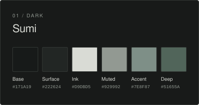
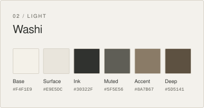
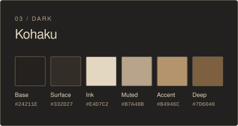
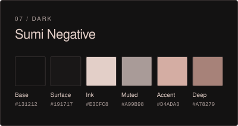

# Oyaishi

大谷石

A restrained Obsidian theme inspired by Japanese Ōya stone, architectural space, and editorial typography. Matte surfaces, fine lines, and quiet color keep the workspace open and composed. 

Ok enough of this AI slop. idk I was working on a different project Yohaku and I made a pretty nice clean aesthetic for it, and lowk wanted to replicate it in Obsidian so here you go, I think its kinda clean compared to the other "minimalist" themes that you see here....
the colors I picked are pretty nice, I also tried to keep everything sharp and clean blending in together without looking like dislocated components from windows' 2023 file browser with some color applied to it - which is unironically exactly what AI gave me, so this is heavily finetuned by me to make it actually nice?
Ok now you can read more AI slop about the theme for details that I absolutely did not bother to take the time to write myself. Oh and also for the different themes youre gonna wanna install Style Settings plugin for that.

## Features

- A minimalist editorial interface with integrated panes and tabs.
- Seven curated palettes, from warm paper to deep black.
- Refined typography with local font stacks and CJK fallbacks.
- Cohesive styling for notes, navigation, prompts, graph, and Canvas.
- Optional customization through Style Settings.

## Palettes

  
  
  
  
  
  
  

## Installation

Requires Obsidian **1.13.0 or later**. No build step is needed.

1. Copy `theme.css` and `manifest.json` into `<VAULT>/.obsidian/themes/Oyaishi/`.
2. Open **Settings → Appearance → Themes** and select **Oyaishi**.

To update, replace those two files, then reselect the theme or restart Obsidian. Installation through Community Themes will be available after publication and approval.

## Customization

Enable the optional **Style Settings** community plugin, then open **Style Settings → Oyaishi**. Choose a palette and adjust local fonts, editor width, line height, heading scale, spacing, or restrained corner radii.

Use Obsidian’s **Light** color scheme for Washi and **Dark** for the other palettes. Without Style Settings, the defaults are Sumi in Dark and Washi in Light.

## License

Licensed under the [MIT License](LICENSE).

