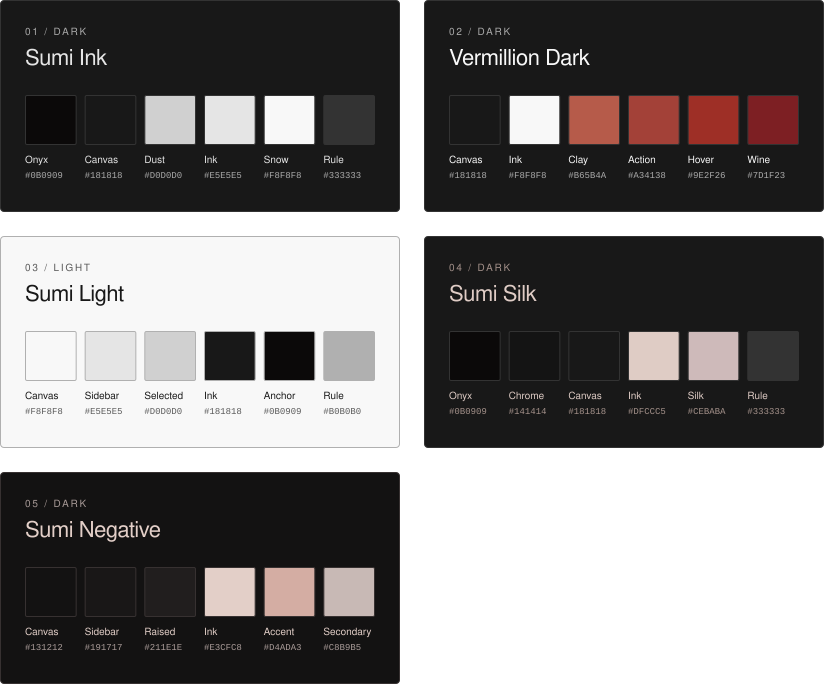

# Oyaishi

大谷石

A restrained Obsidian theme inspired by Japanese Ōya stone, architectural space, and editorial typography. Matte surfaces, fine lines, and quiet color keep the workspace open and composed. 

Ok enough of this AI slop. idk I was working on a different project Yohaku and I made a pretty nice clean aesthetic for it, and lowk wanted to replicate it in Obsidian so here you go, I think its kinda clean compared to the other "minimalist" themes that you see here....
the colors I picked are pretty nice, I also tried to keep everything sharp and clean blending in together without looking like dislocated components from windows' 2023 file browser with some color applied to it - which is unironically exactly what AI gave me, so this is heavily finetuned by me to make it actually nice?
Ok now you can read more AI slop about the theme for details that I absolutely did not bother to take the time to write myself. Oh and also for the different themes youre gonna wanna install Style Settings plugin for that.

## Features

- A minimalist editorial interface with integrated panes and tabs.
- Five curated palettes, from monochrome paper and ink to vermillion and muted rose.
- Refined typography with local font stacks and CJK fallbacks.
- Cohesive styling for notes, navigation, prompts, graph, and Canvas.
- Optional customization through Style Settings.

## Palettes

1. **Sumi Ink** — Dark (default), with monochromatic carbon-black surfaces and pale neutral text.
2. **Vermillion Dark** — Dark, with neutral black surfaces and restrained vermillion accents.
3. **Sumi Light** — Light (default), with `#F8F8F8` canvas, `#E5E5E5` sidebars, and `#181818` ink.
4. **Sumi Silk** — Dark, with `#DFCCC5` ivory text, lighter/dimmer matching inks, and Almond Silk accents.
5. **Sumi Negative** — Dark, restored original warm-neutral blacks, Almond Silk text, and muted rose accents.

Choose the matching Appearance mode, then select a palette in **Style Settings → Oyaishi → Color & atmosphere → Palette**. Existing Sumi Ink and Vermillion selections retain their saved identifiers. Incompatible or retired choices fall back to Sumi Ink in Dark mode or Sumi Light in Light mode; other preferences are not reset.

## Installation

Requires Obsidian **1.13.0 or later**. No build step is needed. Back up any existing Oyaishi `theme.css` and `manifest.json` before replacing them.

1. Copy `theme.css` and `manifest.json` into `<VAULT>/.obsidian/themes/Oyaishi/`.
2. Open **Settings → Appearance → Themes** and select **Oyaishi**.

To update, replace those two files, then reselect the theme or restart Obsidian.

## Customization

Enable the optional **Style Settings** community plugin, then open **Style Settings → Oyaishi**. Choose a palette and adjust local fonts, editor width, line height, heading scale, spacing, or restrained corner radii.

Use Obsidian’s **Light** color scheme for **Sumi Light** and **Dark** for the other four palettes. Without Style Settings, the defaults are **Sumi Ink** in Dark and **Sumi Light** in Light.

**Sumi Silk** and **Sumi Negative** default to the locally installed **Maple Mono NF** for interface, body, and code, with system monospace and CJK fallbacks. No fonts are bundled or downloaded. Saved Style Settings font choices and native Appearance font overrides take precedence; clear those custom choices to use the palette defaults. The other three palettes retain their existing fonts. Fenced code uses native Obsidian syntax roles across all palettes, with darker native hues for readability in Sumi Light.

## License

Licensed under the [MIT License](LICENSE).

